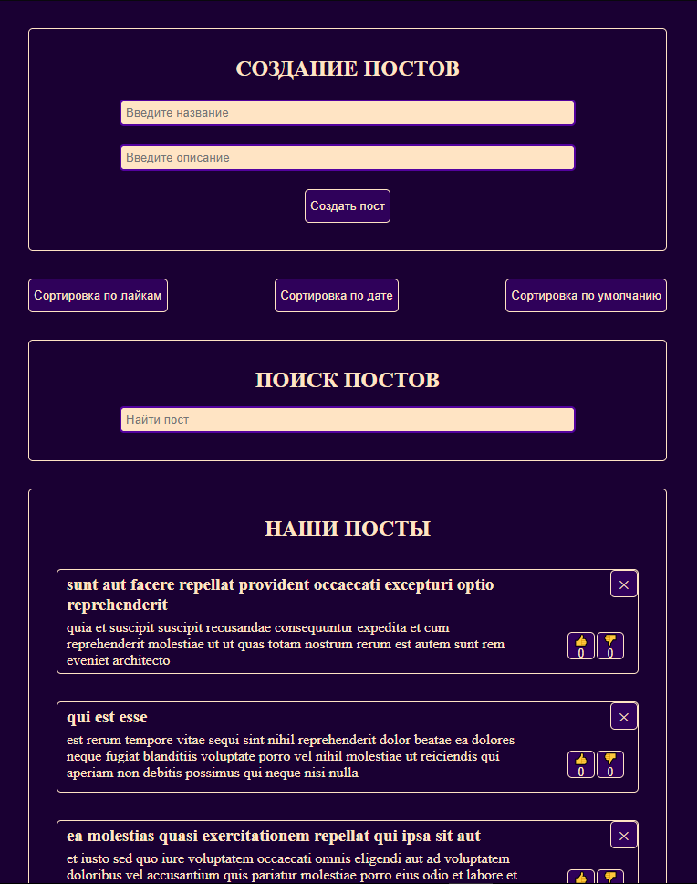

# Posts App

Приложение для публикации постов на React: создание, поиск, сортировка, оценки и удаление с подтверждением. Учебный проект, написанный самостоятельно.

**Демо:** https://posts-app-rust.vercel.app



## Что умеет

- Создание постов с проверкой полей и сообщениями об ошибках под ними
- Лайки и дизлайки: на пост можно поставить одну оценку, голос можно сменить
- Удаление поста с окном подтверждения
- Поиск по названию и счётчик найденных постов
- Сортировка по лайкам, по дате и по умолчанию
- При первом открытии стартовые посты загружаются с API (JSONPlaceholder), с индикатором загрузки и сообщением об ошибке
- Данные хранятся в `localStorage` и сохраняются после перезагрузки страницы
- Адаптивная вёрстка (проверено от 360px)

## Технологии

React, Vite, JavaScript, CSS

Хуки: `useState`, `useEffect`, `useMemo` и собственный хук `useLocalStorage`.

## Как запустить

```bash
git clone https://github.com/111Nikita1/posts-app.git
cd posts-app
npm install
npm run dev
```

Сборка: `npm run build`

## Структура

- `src/components/` страница и список постов, форма (`PostForm`, `PostsList`)
- `src/UI/` переиспользуемые компоненты `MyButton` и `MyInput`
- `src/hooks/useLocalStorage.js` состояние, которое синхронизируется с `localStorage`

## Особенности и ограничения

- JSONPlaceholder это тестовый API: созданные посты на сервер не отправляются, а хранятся только в браузере.
- Окно «Вам понравился наш сайт?» показывается один раз за загрузку страницы (так задумано для демонстрации).
- Если первая загрузка постов не удалась, форма скрыта, а после обновления страницы загрузка повторяется.
